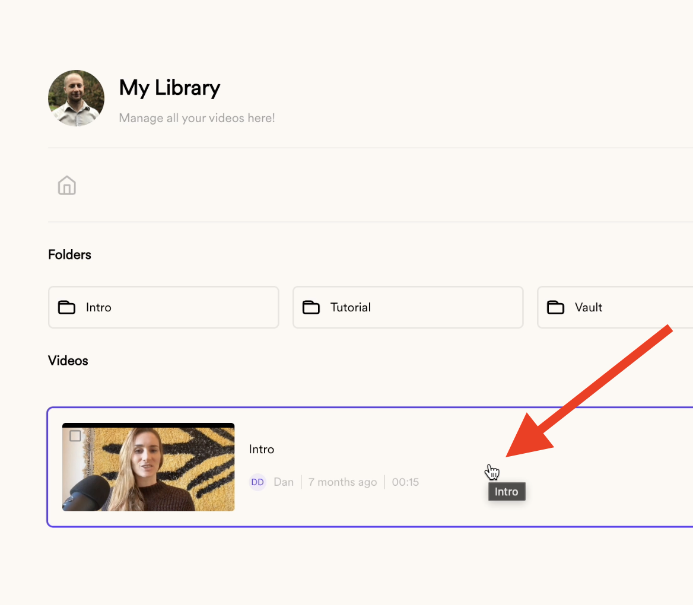
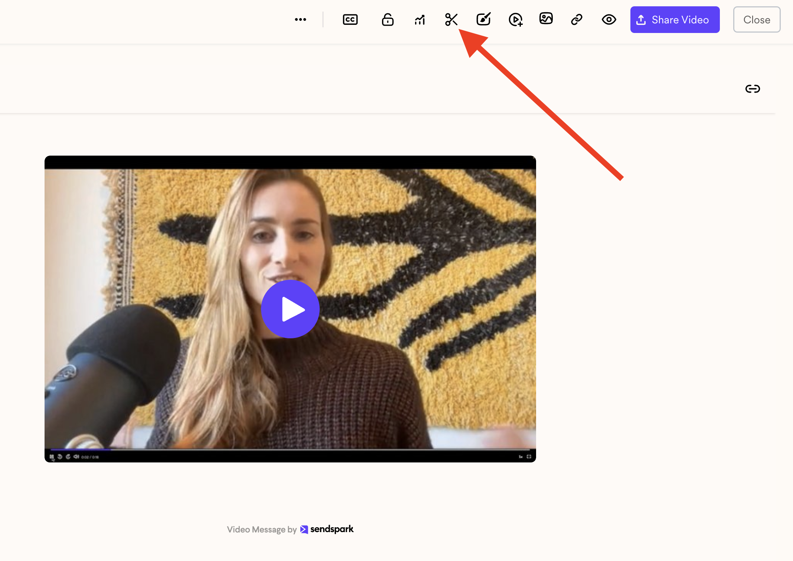
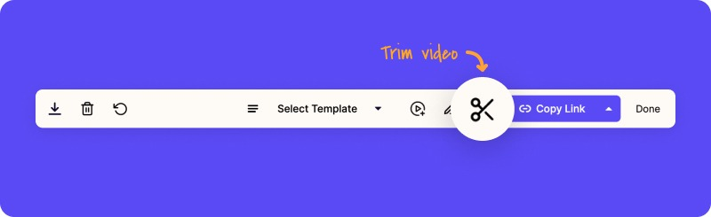
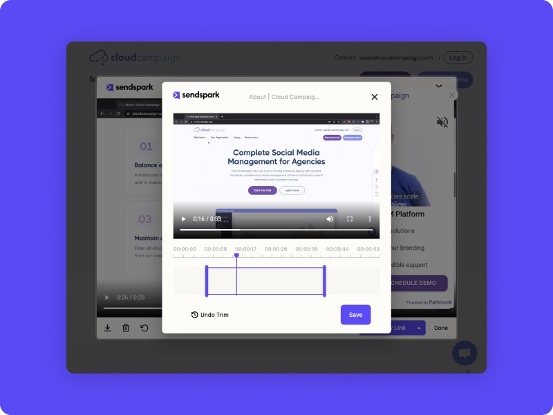

You can trim a Sendspark video from your library's edit page or right after recording it with the Chrome extension. Open the video and click the scissors icon, whose tooltip reads **Create trim**. Drag the bars to cut the beginning or end, or use **Split** and **Remove** to cut a part out of the middle, then click **Save**. Trimming is non-destructive, so **Undo Trim** restores the original video.

## Key takeaways

- Videos can be trimmed from your library edit page or immediately after recording through the Chrome extension.
- In the edit page, click the scissors icon in the top toolbar to open the Trim modal, then drag the purple bars to trim the start or end.
- You can also cut a part out of the middle: click the timeline where the cut begins and click **Split**, do the same where it ends, then select the piece in between and click **Remove**.
- All Sendspark editing is non-destructive, so an "Undo Trim" button restores your original video if you cut too much.
- Trimming currently requires the Sendspark Chrome Extension.

## How to trim videos

Videos can be trimmed from your library by accessing the edit page or right after you record them through the Chrome extension.

## If the video has already been recorded and it's already in your library, you simply need to click on it to gain access to its edit page:

Watch the short walkthrough, then follow the written steps below.

<iframe src="https://www.youtube.com/embed/ToyyAncoAE8?rel=0" allow="autoplay; fullscreen; picture-in-picture; encrypted-media" allowFullScreen />

1. Put your mouse over anywhere on the video, and while highlighted, click on it

2. Once in the Edit Page, you'll notice a toolbar at the top area where you can find the scissors icon to trim the video:

3. That will open the Trim modal, where you can move the purple bars at each end of the timeline to trim the beginning or the end of the video. Once done, simply click **Save**, wait for the confirmation, and close the window.

## How do I cut a part out of the middle of a video?

In the same Trim modal, you can remove any part of the video, not only the start or the end:

1. Click the timeline at the point where the part you want to cut begins.
2. Click the piece of the timeline under that point to select it, then click **Split** in the small menu that appears.
3. Click the timeline where the part you want to cut ends, and click **Split** again. Each piece must be at least 1 second long.
4. Select the piece in the middle and click **Remove**. It turns gray on the timeline.
5. Switch from **Original** to **Preview** above the player to watch the video without the removed piece. The **Duration** readout shows the original length and the new length.
6. Changed your mind? Click **Restore** on the gray piece to bring it back.
7. Click **Save**.

After a trim is saved, **Undo Trim** appears in the Trim modal and brings back your original video.

---

## If you just recorded the video with the Chrome extension, you have a quick shortcut:

1. After recording your video with the Chrome extension, you can click the**trim icon** to trim your video. 
2. From the trim modal, you can move the left and right bars to create the new clip you want to use 
3. Drag the playhead to anywhere in your clip to watch a preview.
4. Click the play button on the video player or the space button on your keyboard to preview the clip.
5. Click **"save,"** and you'll be all set with your new clip.
6. Accidentally cut too much out? No worries! All Sendspark editing is non-destructive, so just click the **"Undo Trim"** button and you'll get your original video back.

## Trim FAQ

## 1. Can I trim videos without the Chrome Extension?

Not at this time. Please install the [Sendspark Chrome Extension](https://chrome.google.com/webstore/detail/sendspark-video-and-scree/blimjkpadkhcpmkeboeknjcmiaogbkph) here to access the trim feature.

---

## Frequently asked questions

<AccordionGroup>
  <Accordion title="Where can I trim a video in Sendspark?">
    From your library by opening the video's edit page, or right after you record it through the Chrome extension using the quick trim shortcut.
  </Accordion>
  <Accordion title="How do I trim a video from the edit page?">
    Open the video to reach the Edit Page, click the scissors icon in the top toolbar to open the Trim modal, drag the purple bars to trim the beginning or end, then click save and wait for the confirmation.
  </Accordion>
  <Accordion title="Can I cut a section out of the middle of a video?">
    Yes. In the Trim modal, click the timeline where the cut begins and click Split, do the same where it ends, then select the piece in between and click Remove. Use Preview to watch the result, Restore to bring the piece back, and Save to finish.
  </Accordion>
  <Accordion title="What if I accidentally trim too much?">
    No worries. All Sendspark editing is non-destructive, so just click the "Undo Trim" button and you'll get your original video back.
  </Accordion>
  <Accordion title="Can I trim videos without the Chrome Extension?">
    Not at this time. You'll need to install the [Sendspark Chrome Extension](https://chrome.google.com/webstore/detail/sendspark-video-and-scree/blimjkpadkhcpmkeboeknjcmiaogbkph) to access the trim feature.
  </Accordion>
</AccordionGroup>

_Updated November 2026._
