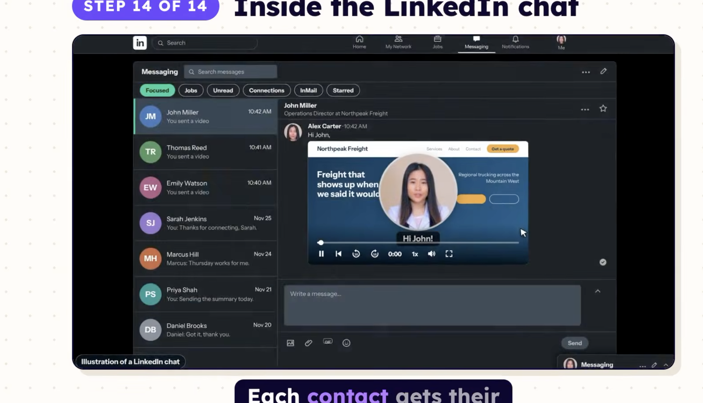

Kerux connects to Sendspark with your API key and secret, then sends each LinkedIn contact their own personalized video automatically. Add a **Sendspark video** step to a Kerux campaign, pick your dynamic video campaign, and attach the video to a message. When a contact accepts your invitation, Kerux requests their video from Sendspark and sends it as a file that plays right inside the LinkedIn chat, with no link to click.

-

## Key takeaways

- You connect the two tools once, with your Sendspark **API key** and **API secret**. Kerux finds your workspace by itself.
- In your Kerux campaign, add a **Sendspark video** step from the **Automations** tab and pick the dynamic video campaign your videos come from.
- With **Embed video**, the video plays inside the LinkedIn chat. Each video uses the contact's first name, with their company website as the background.
- Kerux requests each video when the contact accepts, then checks every 3 minutes for up to 6 hours and sends the message once the video is ready.

Watch the short walkthrough, then follow the written steps below.

<iframe src="https://www.youtube.com/embed/9nkMrz-Xzrs?rel=0" allow="autoplay; fullscreen; picture-in-picture; encrypted-media" allowFullScreen />

## What you need

- A Sendspark account with a [dynamic video campaign](/how-to-create-a-dynamic-video-campaign) set up.
- Your Sendspark [API key and secret](/how-to-create-api-keys).
- A Kerux account. According to Kerux, the Sendspark integration works on their Pro and Agency plans and on the free trial.

## 1. Get your Sendspark keys

1. In Sendspark, click your workspace name at the bottom left and choose **API Credentials**.
2. Click the copy icon next to your **API key**.
3. Click the key icon on the same row to create a **secret key**, and copy it.

If you need a brand-new key, the button at the top right creates a new key and secret together.

## 2. Connect Sendspark to Kerux

1. In [www.usekerux.com](https://www.usekerux.com) , open **Integrations**.
2. Under **Video**, click **Connect** next to Sendspark. The **Open Sendspark** button takes you straight to your API Credentials page if you still need your keys.
3. Paste the **API key** and the **API secret**. Kerux finds your workspace by itself.
4. Click **Save**.
5. Click **Test connection**. When it says **Working**, you are connected.

## 3. Add the video step to your campaign

1. Open your campaign in the Kerux builder.
2. Under **Yes**, click the plus.
3. Open the **Automations** tab and choose **Sendspark video**.
4. Keep **Embed video** selected so the video plays inside the LinkedIn chat.
5. Click **Dynamic video campaign** and pick the campaign your videos come from.

Each video uses the contact's first name, with their company website as the background.

## 4. Attach the video to a message

1. Add a **Message** step and write your note.
2. Click **Add Sendspark video**.

The Video section now says the personalized video is attached when ready, so there is no link to paste.

## 5. Launch the campaign

1. Add your contacts.
2. Flip the switch from **Inactive** to **Active**. Turning it on checks the campaign and publishes it.

Your contacts enter the campaign, and Kerux tells you when the first invitation goes out.

## What happens next

When a contact accepts your invitation, Kerux asks Sendspark for their video on its own. Open the contact's journey in Kerux to follow it: you can see the last check, the next check, and which check it is. With Embed video, Kerux checks every 3 minutes for up to 6 hours.

When the video is ready, the message goes out with the video attached, and the journey shows **Message sent**. Your contact receives the video as a file playing right inside the LinkedIn chat.

For more detail on the Kerux side, see the [Kerux help center](https://usekerux.com/help).

## Frequently asked questions

<AccordionGroup>
  <Accordion title="What do I need from Sendspark to connect Kerux?">
    Your API key and API secret, from API Credentials in your Sendspark menu. Paste both into Kerux and it finds your workspace by itself.
  </Accordion>

  <Accordion title="Do my contacts get a link or the video itself?">
    With Embed video, they get the video as a file that plays right inside the LinkedIn chat, so there is no link to click.
  </Accordion>

  <Accordion title="When is each contact's video created?">
    When the contact accepts your invitation, Kerux asks Sendspark for their video. It then checks every 3 minutes, for up to 6 hours, and sends the message once the video is ready.
  </Accordion>

  <Accordion title="How is each video personalized?">
    Each video uses the contact's first name, with their company website as the background.
  </Accordion>
</AccordionGroup>

## Related articles

- [How to create a dynamic video campaign](/how-to-create-a-dynamic-video-campaign)
- [How to create API keys](/how-to-create-api-keys)
- [AI-personalized videos in LinkedIn automation](/ai-personalized-videos-in-linkedin-automation)

_Updated November 2026._
